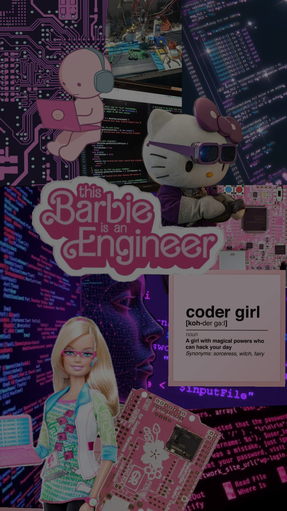
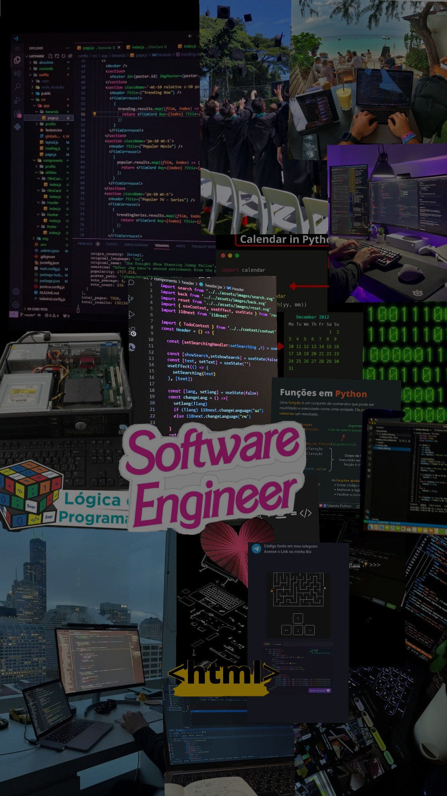
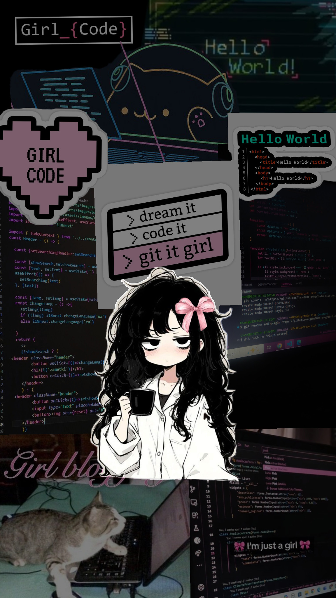

<!-- Custom Hero Banner -->

<!-- Self-Hosted Animated Tagline -->

</a>

 

<!-- Social & Profile Pills -->

  
  
  
  

---

### 🎀 `Girl_{Code}` • About Me

> **`> dream it` • `> code it` • `> git it girl`** 💻✨  
> *🎀 I'm just a girl... who loves dark-mode IDEs, hot-pink syntax themes, and rock-solid distributed backends.*

Hi, I'm **Neha** (`she/her`) — a **Full-Stack Software Developer** obsessed with building interfaces that look effortless and backend systems that never flinch under pressure. 🌸

With **1.5+ years of production full-stack engineering experience**, I design, test, and ship end-to-end features across **React, TypeScript, Python, and Django**—turning complex enterprise and clinical workflows into fast, resilient web applications.

- 🧪 **Test Architecture & Quality:** Scaled automated test suites to **632 tests** across frontend and backend using **Jest, React Testing Library, and pytest** so deployments stay drama-free.
- 🚀 **High-Throughput File Workflows:** Standardized file-handling pipelines across **14 application screens**, boosting upload capacity **6x** and instrumenting **113 failure paths** with **Sentry & OpenTelemetry**.
- 🛡️ **Production Reliability & Security:** Squashed **15 high-priority production exceptions**, architected structured audit logging across **7 core user actions**, executed zero-downtime **MySQL** migrations, and replaced legacy `pickle` serialization with JSON-safe pipelines.
- 🧠 **Applied AI & Computer Vision:** Co-developed an end-to-end **ResNet-50** OCR and translation pipeline converting historical **Modi Script** into Devanagari and English.

 

<b>✨ Click to expand my Education, Projects & Competition Wins</b>

 

- 🎓 **B.E. in Computer Engineering** — *Modern Education Society's Wadia College of Engineering, Pune* (**9.02 / 10 CGPA**)
- 📜 **Handwritten Modi Script OCR & Translation:** Built an automated recognition and translation pipeline converting historical Modi script into Devanagari and English using image preprocessing and **ResNet-50**.
- 🥇 **1st Place — Technovation 2026:** 3rd National-Level Project Competition at MES Wadia College of Engineering, Pune.
- 🌟 **Top 7 Finalist — AIT ACM Nexus 3.0:** National tech showcase at Army Institute of Technology, Pune.
- 🎀 **Leadership & Certifications:** Event Manager at **Techverse MESWCOE**; certified in *Programming in Java* (NPTEL – **IIT Kharagpur**), *Programming, DSA Using Python* (NPTEL – **IIT Madras**), and *The Complete Full-Stack Web Development Bootcamp*.

---

### 💻 Tech Stack & Everyday Toolkit

**Frontend & UI Craft**

  
  
  
  
  
  

**Backend, Databases & Search**

  
  
  
  
  
  

**Cloud, Testing, Observability & AI**

  
  
  
  
  
  

---

### 💖 Featured Builds & Engineering Spotlights

#### 📜 Handwritten Modi Script Recognition & Translation Pipeline
- **What it does:** Digitizes historical handwritten Modi script manuscripts and translates them into modern Devanagari and English.
- **How it's built:** Combines custom OpenCV image preprocessing, character segmentation, and a fine-tuned **ResNet-50** deep learning classifier backed by **Python** and **Supabase**.

#### ⚡ Multi-Screen File Pipeline & Observability Architecture
- **What it does:** Unified fragmented file-upload workflows across **14 production screens** while raising upload capacity **6x**.
- **How it's built:** Engineered shared **React + TypeScript** upload abstractions with strict client-side validation and instrumented **113 granular failure paths** via **Sentry** and **OpenTelemetry**.

#### 🧪 Full-Stack Test Automation & Audit Trail Modernization
- **What it does:** Hardened mission-critical clinical workflows against regressions, silent failures, and unsafe serialization.
- **How it's built:** Expanded test coverage to **632 automated tests** (**Jest, React Testing Library, pytest**), built structured audit logging across **7 user action types**, and migrated legacy `pickle` payloads to JSON-safe handlers.

---

### 🌸 `Hello World` • Coder Girl Moodboard

  
   
  
   
  

  <code>Hello World!</code> • Powered by React, Django, caffeine, and main-character energy ✨

<!-- Footer Wave -->

