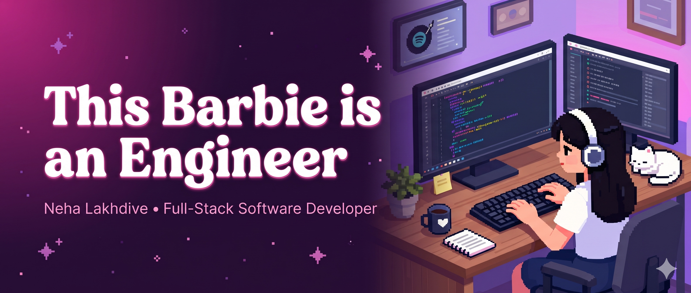

<!-- Custom Hero Banner with coder-girl.jpg in the Background -->

  

<!-- Fixed Animated Typing Tagline (Properly URL-Encoded) -->

 

<!-- Social & Profile Pills -->

  
  
  
  

---

### 🎀 `coder girl` *[koh-der girl]*
> **noun** — *A girl with magical powers who can hack your day.*  
> **Synonyms:** *sorceress, witch, fairy* ✨

Hi, I'm **Neha** (`she/her`) — a **Full-Stack Software Developer** who loves dark-mode terminals with hot-pink syntax highlighting just as much as rock-solid distributed backends. 💻🌸

With **1.5+ years of production full-stack engineering experience**, I build scalable web applications across **React, TypeScript, Python, and Django**—turning complex clinical and enterprise workflows into snappy, intuitive interfaces.

- 🧪 **Testing & Quality:** Scaled automated test suites to **632 tests** across frontend and backend using **Jest, React Testing Library, and pytest**.
- 🚀 **High-Throughput Pipelines:** Standardized file-upload workflows across **14 application screens**, increasing capacity **6x** and instrumenting **113 failure paths** with **Sentry & OpenTelemetry**.
- 🛡️ **Reliability & Security:** Resolved **15 high-priority production exceptions**, engineered structured audit logging across **7 core user actions**, ran zero-downtime **MySQL** migrations, and replaced legacy `pickle` serialization with JSON-safe pipelines.
- 🏆 **AI & Computer Vision:** Co-developed an end-to-end **ResNet-50** OCR and translation pipeline for historical **Modi Script**, winning the **Best Paper Award at ICRACE-2026**.

 

<b>✨ Click to expand my Education, Research & Competition Wins</b>

 

- 🎓 **B.E. in Computer Engineering** — *Modern Education Society's Wadia College of Engineering, Pune* (**9.02 / 10 CGPA**)
- 🏆 **Best Paper Award — ICRACE-2026:** Automated Handwritten Modi Script Recognition & Translation into Devanagari and English using image preprocessing and **ResNet-50**.
- 🥇 **1st Place — Technovation 2026:** 3rd National-Level Project Competition at MES Wadia College of Engineering, Pune.
- 🌟 **Top 7 Finalist — AIT ACM Nexus 3.0:** National tech showcase at Army Institute of Technology, Pune.
- 🎀 **Leadership & Certifications:** Event Manager at **Techverse MESWCOE**; certified in *Programming in Java* (NPTEL – **IIT Kharagpur**), *Programming, DSA Using Python* (NPTEL – **IIT Madras**), and *The Complete Full-Stack Web Development Bootcamp*.

---

### 💻 Tech Stack & Everyday Toolkit

**Frontend & UI Craft**

  
  
  
  
  
  

**Backend, Databases & Search**

  
  
  
  
  
  

**Cloud, Testing, Observability & AI**

  
  
  
  
  
  

---

### 💖 GitHub Activity & Streaks

  

 

  

<!-- Footer Wave -->

