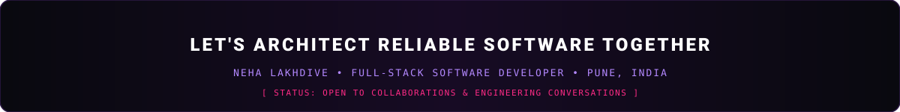

<!-- SECTION 1: IMMERSIVE HERO SECTION -->

  

  

<!-- Primary Contact & Identity Links -->

  
  
  

<!-- Interactive Dashboard Anchor Navigation -->

  <a href="#about-me"><kbd>01 // About Me</kbd></a>  · 
  <a href="#professional-journey"><kbd>02 // Experience</kbd></a>  · 
  <a href="#technical-arsenal"><kbd>03 // Tech Arsenal</kbd></a>  · 
  <a href="#featured-engineering-projects"><kbd>04 // Case Studies</kbd></a>  · 
  <a href="#achievements-and-recognition"><kbd>05 // Recognition</kbd></a>  · 
  <a href="#education"><kbd>06 // Education</kbd></a>  · 
  <a href="#github-activity-dashboard"><kbd>07 // GitHub Metrics</kbd></a>  · 
  <a href="#lets-connect"><kbd>08 // Connect</kbd></a>

<!-- SECTION 2: ABOUT ME -->
## `01 //` About Me

<table>
  <tr>
    <td width="58%" valign="top">
      <h3>Engineering Reliable Systems & Thoughtful Interfaces</h3>
      

        I am <strong>Neha Lakhdive</strong>, a Full-Stack Software Developer with <strong>1.5+ years of production engineering experience</strong> building web applications across <strong>React, TypeScript, Python, and Django</strong>.
      

      

        My work centers on the intersection of responsive frontend architecture and resilient backend systems—turning high-volume clinical and enterprise workflows into fast, observable, and maintainable software. Whether standardizing multi-screen upload pipelines, expanding automated regression suites, or designing audit-safe data models, I prioritize clarity, measurability, and long-term system health.
      

      

        Beyond full-stack product engineering, I explore <strong>applied AI and computer vision</strong>, having co-developed a deep-learning recognition and translation pipeline for historical handwritten Modi script.
      

    </td>
    <td width="42%" valign="top">
      <pre lang="yaml"><code># SYSTEM_PROFILE.YML
developer: "Neha Lakhdive"
role: "Software Developer"
location: "Pune, Maharashtra, India"
core_focus:
  - "Full-Stack Web Architecture"
  - "High-Throughput File Workflows"
  - "Test Automation & Observability"
  - "Applied Computer Vision & OCR"

production_snapshot:
  automated_tests: "632 (Jest, RTL, pytest)"
  upload_capacity: "6x across 14 screens"
  failure_paths_instrumented: 113
  critical_exceptions_resolved: 15
  audit_action_types: 7</code></pre>
    </td>
  </tr>
</table>

<!-- SECTION 3: PROFESSIONAL JOURNEY -->
## `02 //` Professional Journey

### **CrelioHealth** — *Healthcare SaaS (LIMS & RIS Cloud Platform) • Pune, India*

<table>
  <tr>
    <td width="33%" valign="top">
      <h4><code>03 // AUG 2026 – PRESENT</code></h4>
      <h3>Software Developer</h3>
      
<strong>Focus:</strong> Scalable Architecture, Test Engineering & Observability

      <ul>
        <li>Expanded end-to-end automated test coverage to <strong>632 frontend and backend tests</strong> using <strong>Jest, React Testing Library, and pytest</strong>.</li>
        <li>Standardized file-handling workflows across <strong>14 application screens</strong>, delivering a <strong>6x upload-capacity increase</strong>.</li>
        <li>Instrumented structured telemetry across <strong>113 failure paths</strong> using <strong>Sentry</strong> and <strong>OpenTelemetry</strong>.</li>
      </ul>
    </td>
    <td width="33%" valign="top">
      <h4><code>02 // AUG 2025 – AUG 2026</code></h4>
      <h3>Junior Software Developer</h3>
      
<strong>Focus:</strong> Production Reliability, Auditability & Core Workflows

      <ul>
        <li>Diagnosed and resolved <strong>15 high-priority production exceptions</strong> across live clinical modules.</li>
        <li>Architected structured audit logging across <strong>7 core user action types</strong> and executed <strong>MySQL</strong> schema migrations to strengthen data traceability.</li>
        <li>Built interactive data views and real-time integrations with <strong>React, Redux, Django REST Framework, and Redis</strong>.</li>
      </ul>
    </td>
    <td width="33%" valign="top">
      <h4><code>01 // FEB 2025 – AUG 2025</code></h4>
      <h3>Engineering Intern</h3>
      
<strong>Focus:</strong> Data Security & Query Localization <em>(Converted via PPO)</em>

      <ul>
        <li>Eliminated deserialization vulnerabilities by replacing legacy <code>pickle</code> serialization with <strong>JSON-safe pipelines</strong>.</li>
        <li>Engineered localized US-format date search and filtering workflows across patient and diagnostic records.</li>
        <li>Contributed production features across <strong>React, TypeScript, Python, and Django</strong>.</li>
      </ul>
    </td>
  </tr>
</table>

<!-- SECTION 4: TECHNICAL ARSENAL -->
## `03 //` Technical Arsenal

<table>
  <tr>
    <td width="50%" valign="top">
      <h4><code>FRONTEND // UI & CLIENT ARCHITECTURE</code></h4>
      

        
        
        
        
        
        
      

    </td>
    <td width="50%" valign="top">
      <h4><code>BACKEND // APIS & DISTRIBUTED LOGIC</code></h4>
      

        
        
        
        
      

    </td>
  </tr>
  <tr>
    <td width="50%" valign="top">
      <h4><code>DATABASES & INFRASTRUCTURE // STORAGE & CLOUD</code></h4>
      

        
        
        
        
        
        
      

    </td>
    <td width="50%" valign="top">
      <h4><code>TESTING & ENGINEERING // QUALITY & OBSERVABILITY</code></h4>
      

        
        
        
        
        
        
      

    </td>
  </tr>
</table>

<!-- SECTION 5: FEATURED ENGINEERING PROJECTS -->
## `04 //` Featured Engineering Projects

<table>
  <tr>
    <td width="100%" valign="top">
      <h4><code>CASE STUDY 01 // APPLIED AI & COMPUTER VISION RESEARCH</code></h4>
      <h3>Handwritten Modi Script Recognition and Translation Pipeline</h3>
      

        <strong>Problem Statement:</strong> Historical documents written in the cursive Modi script remain largely inaccessible to modern digital search and linguistic analysis due to complex ligatures, stroke variations, and the absence of standardized OCR tooling.
      

      

        <strong>Technical Implementation:</strong> Engineered an end-to-end optical character recognition and transliteration pipeline combining image preprocessing (noise reduction, binarization, and character segmentation) with a fine-tuned <strong>ResNet-50</strong> deep-learning architecture to classify handwritten Modi characters and translate recognized sequences into Devanagari and English.
      

      

        <strong>Key Engineering Highlights:</strong>
      

      <ul>
        <li>Presented research findings at <strong>ICRACE 2026</strong> (1st International Conference on Recent Advances in Computer Engineering) and received the <strong>Best Paper Award</strong>.</li>
        <li>Demonstrated practical preservation and accessibility workflows for archival regional manuscripts.</li>
      </ul>
      

        
        
        
        
         | 
        <a href="[REPOSITORY_URL]"><strong>Repository Link ↗</strong></a>  · 
        <a href="[PUBLICATION_URL]"><strong>ICRACE 2026 Paper ↗</strong></a>
      

    </td>
  </tr>
  <tr>
    <td width="100%" valign="top">
      <h4><code>CASE STUDY 02 // FRONTEND ARCHITECTURE & TELEMETRY</code></h4>
      <h3>Production File Handling and Upload Architecture</h3>
      

        <strong>Problem Statement:</strong> Fragmented file-upload implementations across multiple clinical screens created inconsistent validation behavior, constrained file-size thresholds, and opaque client-side failures during network or format errors.
      

      

        <strong>Technical Implementation:</strong> Consolidated file handling across <strong>14 application screens</strong> into a unified <strong>React</strong> and <strong>TypeScript</strong> upload architecture with upfront client-side format/boundary validation, standardized retry handling, and granular telemetry instrumentation via <strong>Sentry</strong> and <strong>OpenTelemetry</strong>.
      

      

        <strong>Key Engineering Highlights:</strong>
      

      <ul>
        <li>Increased maximum file-upload capacity by <strong>6x</strong> across standardized screens.</li>
        <li>Instrumented <strong>113 distinct failure paths</strong> to turn silent upload errors into actionable observability traces.</li>
      </ul>
      

        
        
        
        
         | 
        <em>Production Engineering Case Study (CrelioHealth)</em>
      

    </td>
  </tr>
  <tr>
    <td width="100%" valign="top">
      <h4><code>CASE STUDY 03 // QUALITY ENGINEERING & DATA INTEGRITY</code></h4>
      <h3>Test Automation and Audit Trail Modernization</h3>
      

        <strong>Problem Statement:</strong> Rapid feature iteration in high-compliance workflows required stronger regression protection, traceable user-action auditing, and the elimination of unsafe legacy object serialization.
      

      

        <strong>Technical Implementation:</strong> Scaled automated unit and integration testing across frontend and backend layers using <strong>Jest, React Testing Library, and pytest</strong>, engineered structured audit logging backed by <strong>MySQL</strong> migrations, and migrated legacy <code>pickle</code> payloads to <strong>JSON-safe serialization</strong>.
      

      

        <strong>Key Engineering Highlights:</strong>
      

      <ul>
        <li>Expanded automated coverage to <strong>632 frontend and backend tests</strong>.</li>
        <li>Implemented structured audit logging across <strong>7 core user action types</strong> and resolved <strong>15 high-priority production exceptions</strong>.</li>
      </ul>
      

        
        
        
        
         | 
        <em>Production Engineering Case Study (CrelioHealth)</em>
      

    </td>
  </tr>
</table>

<!-- SECTION 6: ACHIEVEMENTS AND RECOGNITION -->
## `05 //` Achievements and Recognition

<table>
  <tr>
    <td width="50%" valign="top">
      <h4><code>HONORS, COMPETITIONS & LEADERSHIP</code></h4>
      <ul>
        <li>
          <strong>Best Paper Award — ICRACE 2026</strong> 
          <em>1st International Conference on Recent Advances in Computer Engineering</em> • <a href="[[PUBLICATION_URL](https://drive.google.com/file/d/1447odykK7bYoXd-ls5Ql7b6a6KrsJiP2/view?usp=sharing)]">Paper ↗</a>
        </li>
        <li>
          <strong>1st Place — Technovation 2026</strong> 
          <em>3rd National-Level Project Competition, MES Wadia College of Engineering</em> • <a href="https://drive.google.com/file/d/12WeH34uiqpFl_aQ3mMlGb8amixWc5kov/view?usp=sharing">Certificate ↗</a>
        </li>
        <li>
          <strong>Event Manager — Techverse, MESWCOE</strong> 
          <em>Organized technical events and developer community initiatives during B.E.</em>
        </li>
      </ul>
    </td>
    <td width="50%" valign="top">
      <h4><code>VERIFIED TECHNICAL CERTIFICATIONS</code></h4>
      <ul>
        <li>
          <strong>Programming in Java</strong> 
          <em>NPTEL — Indian Institute of Technology (IIT) Kharagpur</em> • <a href="https://drive.google.com/file/d/1dv-D8H6ypOGziLQDle2yZQblbbFgiAuZ/view?usp=drive_link">Credential ↗</a>
        </li>
        <li>
          <strong>Programming, Data Structures and Algorithms Using Python</strong> 
          <em>NPTEL — Indian Institute of Technology (IIT) Madras</em> • <a href="https://drive.google.com/file/d/1M0yppZdsDQsmpFZGJcMPEqiabsRPs-FM/view?usp=drive_link">Credential ↗</a>
        </li>
        <li>
          <strong>The Complete Full-Stack Web Development Bootcamp</strong> 
          <em>Udemy</em> • <a href="https://drive.google.com/file/d/15FN8StIFPlcKjBotMy2Btq9LhA2OtWUN/view?usp=drive_link">Credential ↗</a>
        </li>
      </ul>
    </td>
  </tr>
</table>

<!-- SECTION 7: EDUCATION -->
## `06 //` Education

<table>
  <tr>
    <td width="75%" valign="middle">
      <h3>Modern Education Society's Wadia College of Engineering, Pune</h3>
      
<strong>Bachelor of Engineering (B.E.) in Computer Engineering</strong>  •  <code>2022 – 2026</code>

    </td>
    <td width="25%" align="center" valign="middle">
      <h4><code>CUMULATIVE GPA</code></h4>
      <h2>9.02 / 10</h2>
    </td>
  </tr>
</table>

<!-- SECTION 8: GITHUB ACTIVITY DASHBOARD -->
## `07 //` GitHub Activity Dashboard

<table>
  <tr>
    <td width="54%" align="center" valign="middle">
      
    </td>
    <td width="46%" align="center" valign="middle">
      
    </td>
  </tr>
</table>

 

  

<!-- SECTION 10: LET'S CONNECT -->
## `08 //` Let's Connect

  

  
  
  

